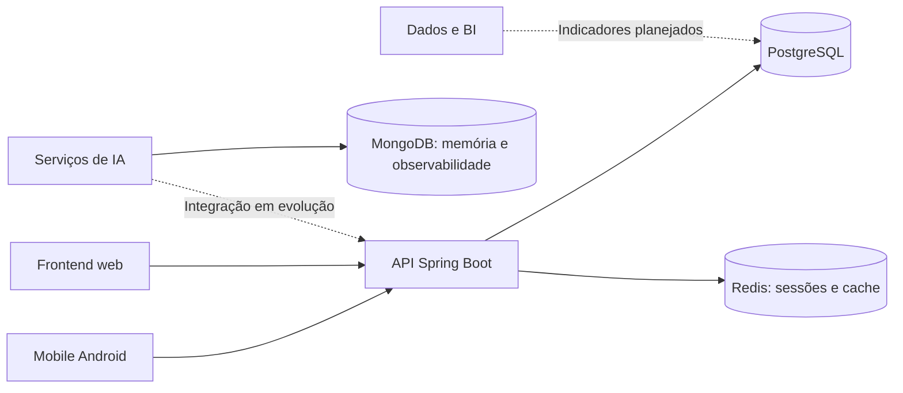

  

  <h1>KAIROS</h1>
  
<strong>Administração inteligente de gôndolas</strong>

  
Estoque, reposição e decisões orientadas por dados em um mesmo ecossistema.

  

    <a href="https://github.com/KairosApplication/kairos-springboot">API</a> ·
    <a href="https://github.com/KairosApplication/kairos-mobile">Mobile</a> ·
    <a href="https://github.com/KairosApplication/kairos-frontend">Frontend</a> ·
    <a href="https://github.com/KairosApplication/kairos-inteligencia-artificial">Inteligência artificial</a>
  

## O que estamos construindo

O Kairos é uma plataforma em desenvolvimento para reduzir rupturas de estoque em gôndolas de supermercados, agilizar a reposição e transformar o histórico operacional em informação para a gestão.

A proposta conecta repositores, vendedores/caixas, clientes e gerentes. Alertas de reposição, rastreabilidade, análise de vendas e recomendações inteligentes fazem parte da visão do produto; a disponibilidade de cada funcionalidade depende do estágio de implementação do respectivo projeto.

## Para quem

| Perfil | Objetivo no produto |
|---|---|
| Repositor | Receber demandas e registrar a reposição para rastreabilidade. |
| Vendedor/Caixa | Registrar compras e, quando aplicável, associá-las ao cliente. |
| Cliente | Consultar produtos e receber uma experiência personalizada. |
| Gerente | Administrar a operação, acompanhar indicadores e apoiar decisões com dados. |

## Arquitetura de referência

O diagrama mostra a organização pretendida do ecossistema, não uma garantia de que todas as integrações já estejam disponíveis.

## Mapa dos repositórios

| Repositório | Responsabilidade | Tecnologia / estágio |
|---|---|---|
| [kairos-springboot](https://github.com/KairosApplication/kairos-springboot) | API principal e regras de negócio | Java, Spring Boot, PostgreSQL e Redis |
| [kairos-mobile](https://github.com/KairosApplication/kairos-mobile) | Aplicativo Android | Kotlin e Gradle |
| [kairos-frontend](https://github.com/KairosApplication/kairos-frontend) | Interface web | React, TypeScript e Vite |
| [kairos-landing-page](https://github.com/KairosApplication/kairos-landing-page) | Páginas estáticas | HTML, CSS e JavaScript |
| [kairos-inteligencia-artificial](https://github.com/KairosApplication/kairos-inteligencia-artificial) | Agentes e experimentação de IA | Python, LangChain/LangGraph e MongoDB |
| [kairos-servlet](https://github.com/KairosApplication/kairos-servlet) | Implementação Servlet | Java, Jakarta Servlet e Maven |
| [kairos-business-intelligence](https://github.com/KairosApplication/kairos-business-intelligence) | Espaço para indicadores e análise | Estrutura inicial |
| [kairos-data](https://github.com/KairosApplication/kairos-data) | Espaço para artefatos de dados | Estrutura inicial |
| [kairos-docs](https://github.com/KairosApplication/kairos-docs) | Espaço para documentação técnica | Estrutura inicial |
| [kairos-infra](https://github.com/KairosApplication/kairos-infra) | Espaço para infraestrutura | Estrutura inicial |
| [.github](https://github.com/KairosApplication/.github) | Perfil e padrões da organização | Templates e guias de contribuição |

## Por onde começar

1. Escolha o projeto pelo mapa acima e siga seu README e instruções de setup.
2. Leia o [guia de contribuição](https://github.com/KairosApplication/.github/blob/main/CONTRIBUTING.md).
3. Procure uma issue ou card do Jira, defina os critérios de aceite e crie uma branch com prefixo adequado (`feat/`, `fix/`, `chore/` etc.).
4. Valide sua mudança com os testes e checks do projeto e abra uma PR focada.

Os templates compartilhados são utilizados quando o repositório não tem templates próprios. A aprovação e os checks obrigatórios são definidos nos rulesets de cada projeto.

## Segurança

Não publique credenciais, cookies, dados pessoais ou detalhes de exploração em issues. Para vulnerabilidades, consulte a [política de segurança](https://github.com/KairosApplication/.github/blob/main/SECURITY.md) e utilize um canal privado.
